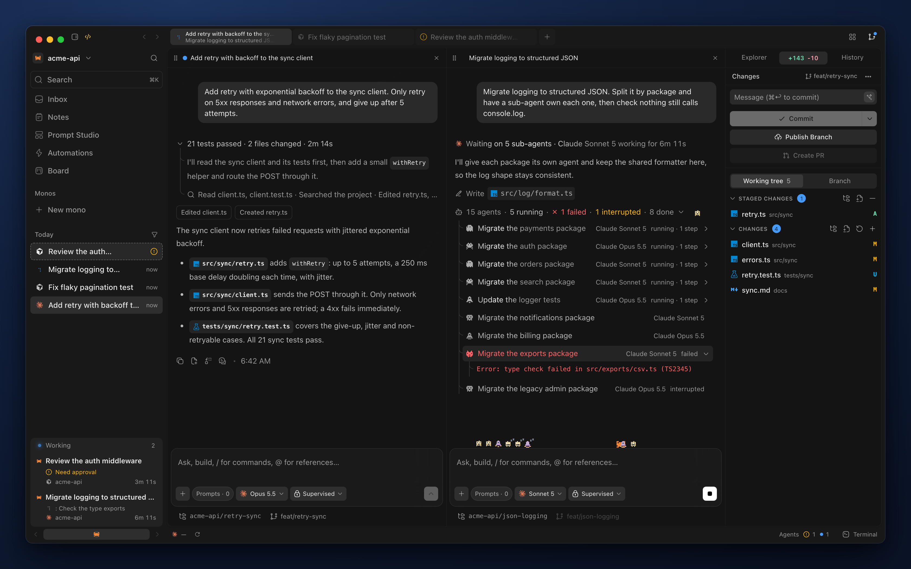
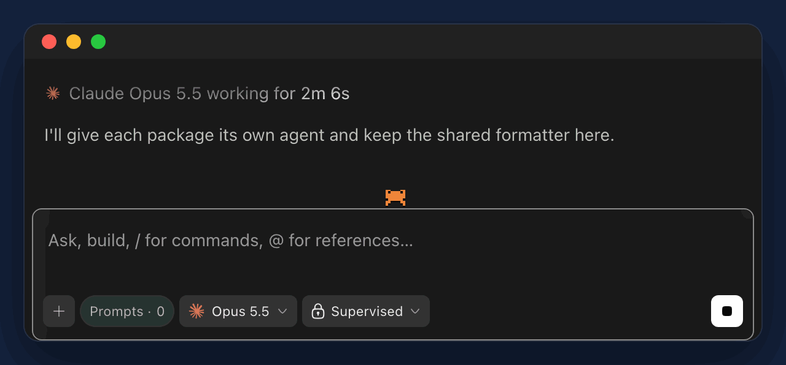

<p align="center">
  
</p>

<h1 align="center">Kode</h1>

<p align="center">
  <strong>Every coding agent. One window.</strong>
</p>

<p align="center">
  Run Claude Code, Codex, Cursor and eight more agents side by side, in your own repos, on the plans you already pay for.
</p>

<p align="center">
  <a href="https://github.com/0x01001011/kode/releases/latest"><strong>Download for macOS</strong></a> ·
  <a href="#install">Install</a> ·
  <a href="CHANGELOG.md">Changelog</a>
</p>

<p align="center">
  
</p>

## One tab per agent

You run more than one agent. Kode gives each a tab, splits tabs into panes and keeps parallel tasks in separate Git worktrees. It runs the agent CLIs you already installed and reuses their logins. It does not sell tokens.

Supported agents: Claude Code, Codex, Cursor, Grok Build, OpenCode, Antigravity, Pi, omp, fx, Hermes Agent and Devin.

## What you get

- Review everything a branch adds on top of `main`, edit files and commit without leaving the window.
- Watch sub-agents as pixel characters on your composer. Running ones run, finished ones sleep, failed ones raise a red "!".
- Type `/operator` and an agent opens sessions, reads other sessions and manages notes.
- Get answers as pages, with plans, forms and charts. One click sends the recommended answers.
- Version prompts in Prompt Studio, mark one Production and insert it with `/`.
- Read a project's Superpowers specs and plans as one task graph.
- Pull Jira Cloud tickets into a session.
- Run sessions on another machine over SSH (experimental).
- Set up Monos, agents that keep a memory and run scheduled tasks (experimental).

<p align="center">
  
</p>

## Install

Kode needs macOS 12 or later on Apple Silicon and at least one supported agent, installed and signed in.

```bash
curl -fsSL https://raw.githubusercontent.com/0x01001011/kode/main/install.sh | bash
```

The script checks your Mac, shows the DMG's SHA-256 fingerprint next to the digest GitHub lists for it, asks before it installs, copies Kode to Applications and clears the macOS quarantine flag. Kode is ad-hoc signed and not notarized, and clearing the flag lets it open. Read [install.sh](install.sh) first if you like.

Options go after `bash -s --`. Use `--check` to run the preflight checks and stop, `--version v0.56.0` for a specific release, `--yes` to skip the question (needed over SSH), `--force` to reinstall, `--dir "$HOME/Applications"` to change the folder and `--no-open` to skip the offer to open Kode.

To install by hand, download the DMG from [Releases](https://github.com/0x01001011/kode/releases/latest), drag Kode to Applications and run this once:

```bash
xattr -dr com.apple.quarantine /Applications/Kode.app
```

Kode updates itself from Settings → General. Builds before 0.26.0 cannot update themselves, so run the script once to move to a build that can.

## Releases

Each release has the DMG, the signed update the app downloads, the `latest.json` update feed and the host packages Kode installs on a remote machine. The [changelog](CHANGELOG.md) lists what changed in every version. Found a problem? [Open an issue](https://github.com/0x01001011/kode/issues).

Kode is closed source. This repository holds the release builds, the installer and the changelog.

## License

[MIT](LICENSE). Kode is not affiliated with or endorsed by the makers of the agents it runs. Their names and logos belong to them and appear only to identify their products.
