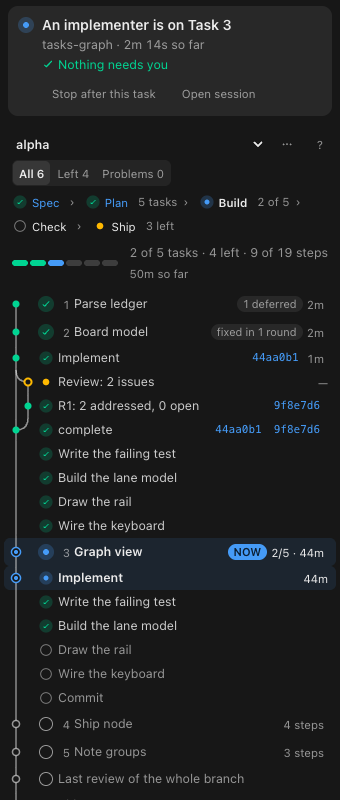
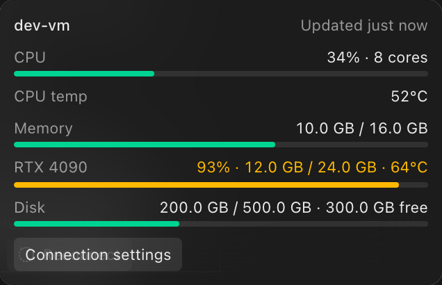

<p align="center">
  
</p>

<h1 align="center">Kode</h1>

<p align="center">
  <strong>A GUI for your coding agents.</strong>
</p>

Kode runs the agents you already use in one window: Claude Code, Codex, Cursor, Grok Build, OpenCode, Antigravity, Pi, omp, fx, Hermes Agent and Devin. If they are installed and logged in, Kode can run them. Tabs are sessions, the composer is the input, and Kode does not sell tokens.

**The source is private.** This repository holds the release builds, the installer and the changelog, and nothing else.

## Install

Kode needs macOS 12 or later on Apple Silicon, and at least one supported agent installed and signed in.

```bash
curl -fsSL https://raw.githubusercontent.com/0x01001011/kode/main/install.sh | bash
```

The script checks your Mac and the latest release, downloads the DMG, shows its SHA-256 fingerprint next to the digest GitHub lists for it, asks before it installs, copies Kode to Applications, and clears the macOS quarantine flag with `xattr -dr com.apple.quarantine` so the first launch is not blocked. Kode is ad-hoc signed, not notarized, and that last step is what lets it open. Read [install.sh](install.sh) first if you like.

Options go after `bash -s --`:

| Option | What it does |
|--------|--------------|
| `--check` | Runs the preflight checks (macOS version, network, free space, install folder, what is installed now) and stops. Nothing is downloaded. |
| `--version v0.26.0` | Installs that release instead of the latest. |
| `--yes` | Does not ask before installing. Needed when there is no terminal. |
| `--force` | Reinstalls a version that is already installed. |
| `--dir "$HOME/Applications"` | Installs there instead of `/Applications`. |
| `--no-open` | Does not offer to open Kode afterwards. |

With no terminal to ask on, such as over SSH, pass `--yes`:

```bash
ssh my-mac 'curl -fsSL https://raw.githubusercontent.com/0x01001011/kode/main/install.sh | bash -s -- --yes'
```

To do it by hand, download the DMG from [Releases](https://github.com/0x01001011/kode/releases/latest), drag Kode to Applications, and clear the download flag once:

```bash
xattr -dr com.apple.quarantine /Applications/Kode.app
```

Kode updates itself from **Settings → General**. Builds before 0.26.0 check the old address for updates and cannot update themselves: run the script once to move to a build that updates from here.

## Superpowers tasks

Kode reads a project's Superpowers specs and plans and shows them as one task graph: the Spec › Plan › Build › Check › Ship flow, every task with its steps, review rounds and commits, the task an agent is on now, and what is left.

<p align="center">
  
</p>

## Remote projects over SSH

Open a folder on another Mac or Linux machine as a project. Kode connects over SSH, downloads the host package for that machine from the release with the same version as your app, verifies its checksum, installs it as a background service and opens a private SSH forward. Agent sessions run on the host, so they keep going when you close Kode or lose the connection. The footer shows the machine's load.

<p align="center">
  
</p>

Remote sessions are experimental. Hosts run on macOS and Linux, on arm64 or x64.

## What is in a release

| File | What it is |
|------|------------|
| `Kode_<version>_aarch64.dmg` | The installer for macOS on Apple Silicon. |
| `Kode.app.tar.gz`, `Kode.app.tar.gz.sig` | The signed update the app downloads. |
| `latest.json` | The update feed the app checks. |
| `kode-host-<os>-<arch>.tar.gz`, `.sha256` | The host Kode installs on a remote machine over SSH, for `darwin` and `linux` on `arm64` and `x64`. |

The [changelog](CHANGELOG.md) lists what changed in every version. Found a problem? [Open an issue](https://github.com/0x01001011/kode/issues).

## License and credits

Kode is a fork of [MonoCode](https://github.com/hardbeat920/monocode) by Nick and the MonoCode contributors, used under the MIT License (see [LICENSE](LICENSE)).

Kode is not affiliated with, endorsed by, or sponsored by the makers of the agent harnesses it can drive. Provider marks that appear in the UI (including Claude, Codex, Cursor, GitHub, GitLab, Linear, Grok, OpenCode, Pi, omp, fx, Hermes, Nous Research, Devin, and Cognition) are trademarks of their respective owners and are used only to identify those products.
